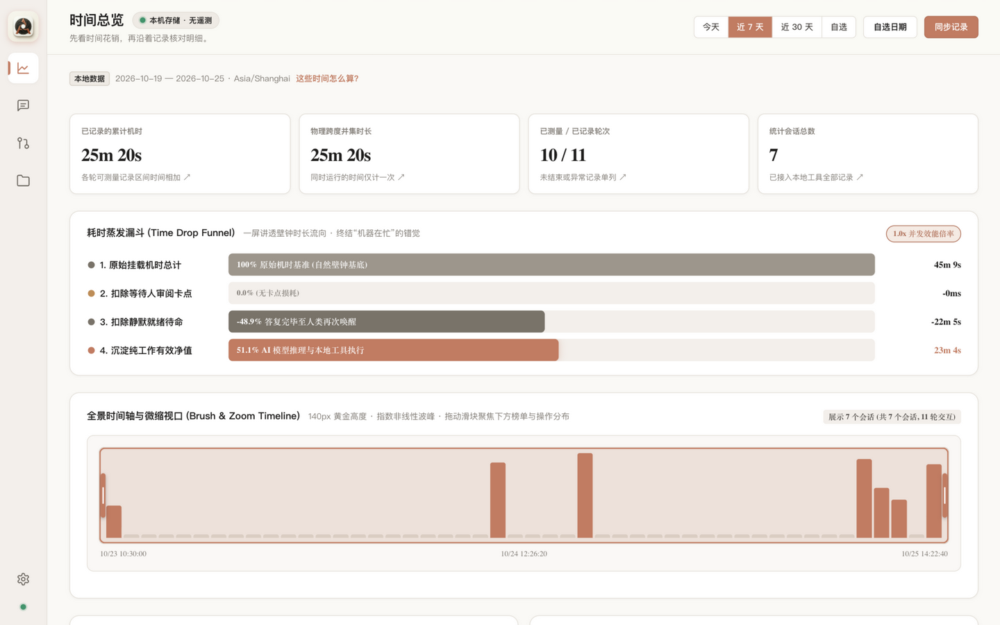
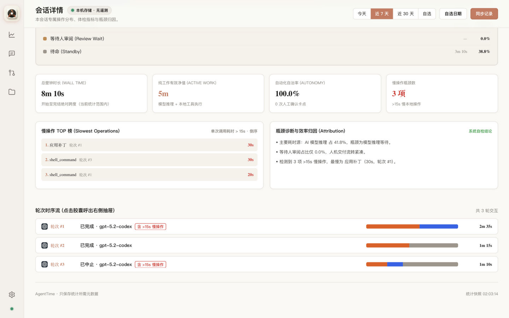
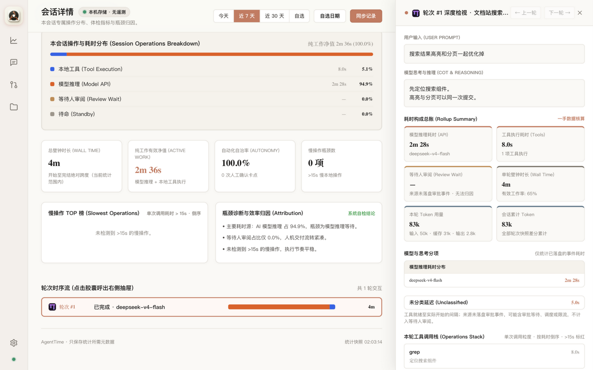
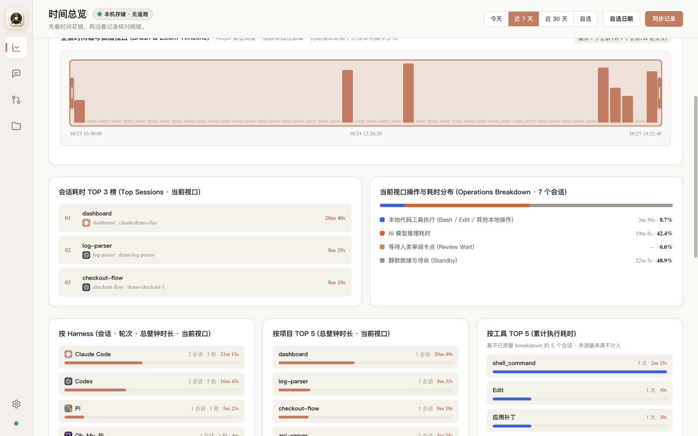
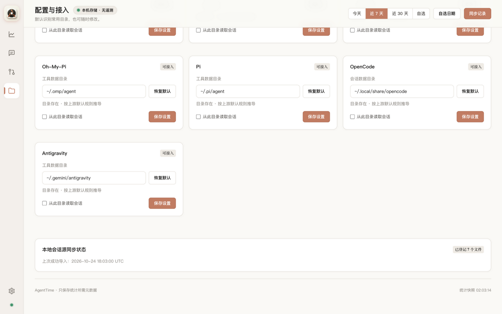

<div align="center">


# AgentTime

**A time ledger for your AI coding agents.**

[](https://github.com/ccclucky/agent-time/actions/workflows/ci.yml)
[](https://www.npmjs.com/package/@ccclucky/agent-time)
[](LICENSE)
[](#quick-start)

[简体中文](README.md) · **English**

</div>

---

AgentTime is a **local-first** time ledger for AI coding agents. It imports sessions from Codex, Claude Code, Pi, Oh-My-Pi, DeepSeek Harness, Antigravity, and OpenCode, splits the recorded time into **pure work, review wait, and standby**, and drills every total down to a single session, turn, and tool call.

How much did your agents actually work today — and how much went into waiting for your approval? Open the page and see.



## Why

- How much of my agents' day was **real work**?
- Within a session, how much went to model inference, command execution, or waiting for me?
- Which sessions are the most expensive? How do agents and models differ?

Typical time tracking counts the whole "start to finish" span as work — **your reading, thinking, and approval time all get billed as AI effort**. AgentTime splits that bill using first-hand evidence from the session event streams.

## The three-state timing model

| State | Meaning | Measured from |
| --- | --- | --- |
| **Pure work** `work_ms` | Model inference + local tool execution | First-hand machine time accumulated from response spans and paired tool spans |
| **Review wait** `review_wait_ms` | Human approval / confirmation blocks | Only counted when the source records approval events; otherwise honestly reported as unknown — never invented |
| **Standby** `standby_ms` | Reply-finished → next submission interval | Turn boundary arithmetic; includes your reading and thinking time |

Accompanying drill-downs: four turn KPIs (wall time / active work / autonomy / slow ops), per-turn rollup, slowest-operations ranking, per-model and per-thinking-level breakdowns, and per-turn token usage. **Missing evidence is always labeled as such — never extrapolated.** That is AgentTime's first design principle.

## Quick start

```sh
npx @ccclucky/agent-time
```

Open `http://127.0.0.1:8765` (bound to localhost only), enable your agents' data directories on the sources page, and hit "Sync records". Or install globally:

```sh
npm install -g @ccclucky/agent-time
agent-time        # dash-less alias: agenttime
```

Requires **Node.js ≥ 22.15** (built-in SQLite and zstd; no native builds). The CLI also supports `--port`, `--db`, and standalone `import --agent <adapter> <path>` — see `agent-time --help`.

## Supported harnesses

All imports are read-only; formats keep adapting as upstreams evolve (design decisions in [docs/adr](docs/adr/)):

| Harness | Three-state timing | Token drill-down | Turn Inspector drawer | Notes |
| --- | --- | --- | --- | --- |
| Codex | ✔ completion-anchor calibrated | ✔ cumulative snapshot diff | ✔ | Official reasoning is encrypted (ZDR); honestly labeled |
| Claude Code | ✔ message-record spans | — | ✔ | Main transcript stream |
| Pi | ✔ first-hand machine-time accumulation | — | ✔ | Branch topology; only the active path |
| DeepSeek Harness | ✔ | ✔ per-request | ✔ | Multi-frame zstd event stream |
| Antigravity | ✔ `ask_question` counted as review wait | — | ✔ | Background tasks counted on completion receipts |
| OpenCode | ✔ | ✔ per-request | ✔ | SQLite session store, one DB many sessions |
| Oh-My-Pi | ✔ history.db anchor fallback | ✔ per-request | ✔ | Legacy files get second-precision anchors, disclosed |

## Privacy: local-first, zero telemetry

- The server binds to `127.0.0.1` only — **no telemetry, no uploads, no accounts**;
- One local SQLite metadata database; **tool arguments, prompt source text, and credentials are never persisted**;
- Turn Inspector reads prompt/thinking text **on demand from local source files** when the drawer opens — never stored, never uploaded;
- AgentTime never reads credential files and never scans outside your configured data directories.

## Screenshots

**Session detail**: three-state split, four KPIs, slowest operations, and attribution.



**Turn Inspector drawer**: the turn's prompt, model reasoning, tool call stack with per-call durations — extracted on demand.



**Aggregation panels**: top sessions, operations breakdown, per-harness / project / tool rollups.



**Sources**: seven harnesses on one page; toggle to enable, custom paths supported.



## How it works

```text
Local session sources (per-harness data dirs / SQLite stores, read-only)
        │  event stream parsing (one adapter per harness)
        ▼
Normalized event stream (start/complete/abort · model · tool_use/tool_result …)
        │  three-state split (calculateEventTiming / calculatePiTiming)
        ▼
Local SQLite stats store (metadata) ──▶ local web UI (127.0.0.1:8765, zero-dependency frontend)
```

Re-imports are idempotent; files that change mid-sync keep their previous snapshot and surface an honest error; known duplicate sources such as fork copies are excluded by design and reported separately.

## Development

```sh
git clone https://github.com/ccclucky/agent-time && cd agent-time
npm ci
npm test          # 244 tests
npm run dev       # run from source
```

Want demo data? `npx tsx scripts/make-demo-data.mts /tmp/agenttime-demo` generates a fully synthetic multi-harness dataset (the script prints the serve command). Every screenshot in this README comes from it.

Contributions welcome — new harness adapters, timing-disclosure refinements, and frontend polish are good starting points. See [CONTRIBUTING.md](CONTRIBUTING.md).

## FAQ

**Does it slow my agents down?** No. Imports are read-only parsing — no hooks, no injection; your agent processes never notice.

**Why does "review wait" show "—" for some sessions?** That source records no approval events. AgentTime refuses to treat missing evidence as "zero wait" — an intentional honesty policy.

**Does any data leave my machine?** No. No telemetry, no uploads, no accounts; all computation and storage stay local.

**Team aggregation?** This version is a personal, single-machine ledger. Multi-machine aggregation is on the roadmap — never at the cost of local privacy.

## License

[MIT](LICENSE)
